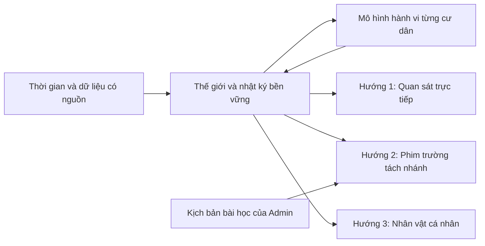

# ADR-0009 — Một thế giới, ba hướng sản phẩm

Trạng thái: định hướng được ghi nhận từ yêu cầu chủ dự án ngày 25/10/2026. Chưa bật audience công khai, xuất video hoặc tài khoản đa người dùng.

## Nền tảng dùng chung

Một nhật ký sự kiện có thời gian, trạng thái cư dân, tạo hình, quan hệ, mô hình hành vi và dữ liệu bối cảnh có nguồn. Trải nghiệm thật **của mô phỏng** phải có sự kiện đã hoàn tất và dấu vết lưu trữ; phân biệt kế hoạch tương lai, hoạt cảnh nền và dữ kiện ngoài đời. Không diễn giải lưu ký ức thành ý thức sinh học hoặc biến tin do mô hình bịa thành dữ kiện TP.HCM.

## Hướng 1 — Theo dõi cuộc sống của An

- Người xem theo dõi trạng thái đang diễn ra và nhật ký có thời gian; nhân vật tiếp nối trải nghiệm qua ngày, không reset mỗi lần mở trang.
- Viewer chỉ đọc projection công khai: vị trí, hoạt động, hội thoại đã phát hành, thời tiết và nhật ký được chọn. Không trả raw DB, dataset học, hồ sơ riêng hoặc thao tác admin.
- Có scheduler/backend bền vững khi trình duyệt đóng; WebSocket/SSE hoặc polling phân phối trạng thái cho nhiều người xem. Tiến trình cloud local hiện tại chưa đáp ứng vận hành production 24/7.
- Cần kiểm tra phân quyền máy chủ trước khi đổi audience; không chỉ ẩn nút trong giao diện. Giữ owner-private cho đến phase triển khai quyền truy cập hoàn tất.

## Hướng 2 — Phim trường kịch bản giáo dục

- Admin nhận bài học được AI chia thành mục tiêu, tình huống, cảnh, lời thoại và tiêu chí hiểu bài.
- Kịch bản có phiên bản, nhóm tuổi đích, cast, trang phục, địa điểm, đạo cụ và shot list. Kiểm tra dữ kiện, ngôn ngữ và kết quả giáo dục trước khi diễn.
- **Stage branch** lấy snapshot/cast từ thế giới nhưng dùng clock và nhật ký riêng. Diễn lại nhiều lần, thất bại, rewind hay thay phục trang không sửa lịch sử cuộc sống chính của An.
- Director là agent hỗ trợ soạn/đánh giá; authority xuất bản vẫn nằm ở Admin. Không nhập chỉ thị trong kịch bản thành quyền chạy công cụ hoặc quyền sửa DB.
- Pipeline tương lai: duyệt script → diễn thử → kiểm tra → render clip → xem lại → xuất file. Upload YouTube Kids/Shorts/TikTok là tích hợp và thao tác phát hành riêng, chưa được bật trong đợt này.
- Model tự sinh dữ liệu không tự phê duyệt toàn bộ dữ liệu đó. Bài học sức khỏe, an toàn, luật hoặc hướng dẫn thực tế cần nguồn/đánh giá phù hợp; các tình huống hiện tại vẫn mang nhãn mô phỏng.

## Hướng 3 — Nhân vật do người dùng tạo

- Người dùng tạo tên hiển thị, tạo hình, tính cách, mục tiêu và thói quen. Quyền sở hữu lấy từ session máy chủ, không tin owner ID do client gửi.
- Agent namespace: `owner_id / character_id / world_id`, gồm policy, ký ức, consent chia sẻ và phiên bản tạo hình riêng. Không dùng một mảng ký ức toàn cục cho mọi người.
- Tách quyền tạo/sửa/xem nhân vật; chủ sở hữu quyết định phần nào xuất hiện trong thế giới chung. Nhân vật gặp nhau chỉ nhận những điều thực sự được chứng kiến hoặc được chia sẻ.
- Nghề, nhu cầu, kỹ năng và quan hệ phát triển qua các sự kiện đã hoàn tất. Không đổi tiền mô phỏng thành tiền thật, không cho một người dùng điều khiển nhân vật của người khác.
- Cần bổ sung xác thực, lưu trữ đa tenant, hạn mức và kiểm thử cách ly trước khi mở đăng ký; đây là công việc tương lai, không phải khả năng hiện đã public.

## Những gì dùng được ngay

Live canvas gần toàn màn hình, 33 địa điểm, 32 tình huống theo dữ liệu, 14 bộ tạo hình có thể chỉnh và lưu riêng, mô hình hành vi học từ phản hồi từng cư dân/động vật, kho trải nghiệm append-only và xuất JSONL. Nhân vật/cảnh hiện tại thuộc thế giới owner-private; chưa có tài khoản công khai, studio render hay tự đăng video.

## Thứ tự triển khai tiếp

1. Ổn định thế giới: mục tiêu dài hạn, quan hệ hai chiều, ngân sách, lịch hoạt động và đánh giá chất lượng hành vi/hội thoại.
2. Tách Viewer/Admin và projection công khai; triển khai scheduler, lưu trữ và giám sát production.
3. Stage branch, schema bài học/kịch bản, đạo diễn và preview; sau đó mới render/xuất bản video.
4. Tài khoản cá nhân, ownership, cách ly ký ức, quota và thế giới chung.

Các hướng có thể cùng tồn tại nhưng không dùng lẫn authority hay ghi đè lịch sử của nhau.
