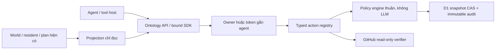

# Ontology: agent phát triển và domain mô phỏng

## Audit và quyết định kiến trúc

| Thành phần đã có | Tái sử dụng / ranh giới |
|---|---|
| `lib/world.ts`, `lib/living/schema.ts` | Person/Resident, nghề nghiệp, plan, quan hệ. Đây là domain mô phỏng; role nghề nghiệp không cấp quyền phát triển. |
| `lib/living/director.ts`, `expansion.ts`, event schema | Proposal/rules được kiểm tra độc lập với LLM; giữ nguyên planner, học, reward và source ownership. |
| `lib/store.ts`, `db/schema.ts` | D1 SQLite/Drizzle, snapshot revision; không cần graph DB. GET ontology không dùng `readWorld` vì helper đó có thể bootstrap/repair. |
| policy/ground/backfill stores | Tái sử dụng mô hình exact-source CAS, operation ID, batch và postassert; không ghi lại world/policy sang kho ontology. |
| `lib/admin.ts`, `worker/index.ts`, bounded-json | Giữ owner boundary hiện có. Namespace ontology có token riêng cho agent, không cấp quyền vào API cũ. |
| `.github/workflows/asset-maintenance.yml` | CI project có job `verify`; QA giữ workflow/deployment riêng. Chưa có GitHub client/service, Task/bug ownership hay Workflow runtime trong app. |
| PR template và runbook QA | QA/CI phải cùng SHA; build không thay authenticated runtime/independent QA. Ontology không tự merge hoặc deploy. |



## Kế hoạch theo phần nhỏ

1. **O1:** Schema, consistency, DAG/ownership/QA policy thuần và unit tests.
2. **O2:** Registry + D1 transactional state/audit/idempotency; fault/concurrency tests trước HTTP.
3. **O3:** Namespace API opt-in, token giới hạn theo agent và SDK/tool bindings; projection domain chỉ đọc, integration/legacy regression.
4. **O4:** GitHub read-only verifier đối chiếu repo/workflow/job/latest run/head SHA; kiểm các trường hợp giả, stale, failed và đổi head.
5. **O5 — rollout riêng:** backup/schema thật, apply migration0013, owner initialize/issue credential, nghiệm thu Access/traffic/native quota và QA cùng SHA trước tích hợp rộng. Không tự migrate hoặc merge QA/main.

## Hợp đồng thiết kế

Development entities: Agent, Repository, Workflow, Task (code/bug/review), PullRequest. Permission roles là catalog code, không phải prompt hoặc profession. Quan hệ typed: assigned_to, depends_on, part_of, targets và concerns (pointer born+actor của simulation). Một task có tối đa một owner/workflow/PR; dependency không được tự tham chiếu hoặc tạo chu kỳ. Không tạo quan hệ vào entity thiếu hoặc sai loại. Blocking là dữ liệu dẫn xuất, không có cờ thứ hai dễ bị lệch.

Workspace snapshot mới chỉ chứa dữ liệu phát triển. Giới hạn working set và JSON size làm lỗi rõ ràng thay vì tải graph vô hạn; adapter domain lấy source revision/born từ world hiện có và chỉ trả metadata cho phép. Sau giới hạn hiện tại có thể tách entity/relation sang bảng indexed trong D1 theo expand/migrate; chưa có lý do thêm graph database.

Quyền được server xác định: owner hiện hữu hoặc hash token ngẫu nhiên gắn agent, expiry/revocation và trạng thái agent. Không nhận role/principal từ body/header tự khai. Agent có thể đọc chung trạng thái qua API/SDK; mọi mutation qua registry, kiểm input/output, policy và revision. Token ontology không dùng được để sửa world hoặc gọi API owner cũ. Credential trả secret đúng một lần; audit/receipt không lưu secret, retry trả metadata để owner cấp token mới khi mất ACK.

Task todo → in_progress → in_review → done; assignee mới bắt đầu/gửi review. Reviewer agent không tự duyệt task mình sở hữu. Code/bug done cần PR và CI được server đọc lại; workflow complete cần các task hoàn tất và QA cùng head. Không có action merge/deploy hoặc shell execution; LLM không tạo evidence đáng tin bằng JSON.

GitHub verifier chỉ GET `api.github.com`, không nhận URL tùy ý. Required workflow path/job do owner cấu hình; kiểm repo ID, head, workflow identity, latest run/attempt và job completed/success. Không dùng check name hoặc client `{passed:true}` làm chứng cứ. Readback head lần cuối phát hiện đổi head trong quá trình kiểm. External state có thể đổi sau quan sát: evidence là timestamped observation, không phải quyền merge bền vững; action merge không tồn tại.

## Persistence và migration

0013 là expand-only: ontology_states, ontology_audit và ontology_credentials. Không backfill/reset world, memory, plan, policy hoặc journal cũ; không tăng cron/pulse/polling. Feature mặc định OFF, thiếu schema trả unavailable; GET không bootstrap. Initialize là action owner có audit. CAS state và audit cùng batch; postassert phát hiện silent-ignore/tamper và rollback. Operation ID gắn principal+canonical input hash, replay không thực hiện lại tác động. Audit append-only; token hash/expiry/revocation có journal mutation tương ứng.

Rollback vận hành: tắt `XOM_ONTOLOGY_ENABLED`; giữ bảng/audit/credential để điều tra. Trước bật remote phải backup+restore rehearsal, kiểm schema/binding/auth hiện hành theo [runbook](PRODUCTION_RUNBOOK.md). Không tự xóa bảng để rollback. Database hiện hành chưa được migrate bởi tác vụ này.

API, ví dụ và kết quả nghiệm thu được cập nhật cùng implementation. Backlog rollout duy nhất ở [ROADMAP](../ROADMAP.md).

## API và Agent integration v1

`XOM_ONTOLOGY_ENABLED=true` bật namespace; mặc định OFF. Tất cả GET và POST cần owner hiện hữu hoặc `Authorization: Bearer ont1_…` do owner cấp. Bearer luôn được giảm xuống agent đã lưu, kể cả localhost/owner session; role header và principal trong body không có tác dụng. HTTPS bắt buộc ngoài loopback. Không đưa owner credential, DB binding hoặc raw network tools vào LLM. Trên QA còn cần Access hiện hành; không thay audience để bật ontology.

| Endpoint | Hợp đồng |
|---|---|
| GET `/api/ontology?view=schema` | Entity/relationship schema, permission-role catalog chỉ đọc và limits. Simulation profession không thuộc catalog này. |
| GET `?view=actions` | JSON Schema input registry và tên action; merge/deploy không tồn tại. |
| GET `?view=entities&kind=task&limit=50` | Keyset paging; `revision` optional làm fence giữa các trang, `next` là cursor tiếp theo. Role entities/has_permission_role được dẫn xuất từ catalog code và agent.roles. |
| GET `?view=relationships&from=task:bug` | Quan hệ typed, lọc kind/from/to. Không ghi hoặc sửa khi đọc. |
| GET `?view=analysis` | Blocking dependency, task không owner/owner inactive, bug chưa giao, QA stale/head mismatch và domain reference đã mất/khác born. |
| GET `?view=domain` | Cần domain-reader; core/resident/profession/household/plan metadata + world revision/born. Không memory, policy, transcript hoặc physical receipt. |
| GET `?view=audit&after=0&limit=50` | Chỉ owner/auditor. Cursor sequence tăng dần; input an toàn, role/policy version, source/CI facts và kết quả. Không secret, title/free text hoặc Authorization. |
| POST `/api/ontology/actions` | Envelope `{operationId,expectedRevision,action:{type,input}}`; strict JSON UTF8 ≤8KiB, Origin có mặt phải cùng site. Output typed `{ok,code,revision,changed,duplicate,data?}`. |

Validation và permission do server quyết định. 400=input;403=quyền/credential;409=state/dependency/QA conflict;413=body;503=OFF/schema/storage/provider. Mutation bị từ chối sau envelope hợp lệ có audit, không đổi head. Unauthenticated/malformed envelope bị chặn trước ghi để tránh biến request rác thành D1 writes. Retry dùng **cùng envelope/operationId**; UUID chuẩn hóa lowercase, không tự đổi UUID sau timeout. Credential issue chỉ trả secret trong ACK đầu; duplicate chỉ trả credentialId. Owner revoke token cũ rồi cấp mới nếu mất ACK, không lấy lại plaintext từ journal.

Permission catalog duy nhất ở `policy.ts`: reader; developer (own task progress); reviewer (review độc lập); maintainer (manage tasks/workflow/PR); auditor; domain-reader. Agent không được grant role/issue credential/register repository policy. Chủ sở hữu có các action quản trị này nhưng vẫn phải qua consistency/QA/CAS. Việc chọn profile repository+required workflows là quyết định owner; definitionSha là Git blob SHA của workflow đã review. Dùng `git rev-parse <reviewed_commit>:.github/workflows/asset-maintenance.yml`, không lấy pin từ đề xuất LLM chưa review. Thay QA profile cần repository entity mới có ID phiên bản; không sửa âm thầm bằng chứng lịch sử.

GitHub workflow/job/latest attempt và workflow **definition blob SHA** đều được kiểm bằng API ở source head. Repository public đọc không token; private có thể cung cấp `XOM_ONTOLOGY_GITHUB_TOKEN` read-only qua secret runtime hoặc inject verifier trong host. Không ghi token đó vào DB/prompt/audit/Git. Fork PR, pagination thiếu jobs, source đang đổi, workflow đã thay, pending/failed/skipped/missing đều không được duyệt. CI observation không thay independent review/native QA theo runbook.

### Ví dụ host và quy trình sửa bug

```ts
import { createOntologyAgentTools } from './lib/ontology/agent.ts';

// verifiedAgentId phải do host xác thực, không lấy từ tool arguments của LLM.
const tools = createOntologyAgentTools(env.DB, {
  kind: 'agent', id: verifiedAgentId,
});
const graph = await tools.query();
const request = {
  operationId: crypto.randomUUID(), expectedRevision: graph.revision,
  action: { type: 'task.transition', input: {
    id: 'task:graphics-bug', state: 'in_review',
  } },
};
const result = await tools.request(request);
// Mất ACK: gửi lại request này;409 thì đọc state và lập đề xuất mới.
```

Owner initialize → register builder/reviewer với role khác nhau → issue token có expiry → register repository profile (fullName, workflow path/job/pin) → maintainer tạo bug và assign builder → thêm dependency/workflow/domain pointer bằng relationship.add → builder in_progress/in_review → track PR bằng server verifier → reviewer yêu cầu done với `expectedHeadSha` đúng head đã xem → server đọc lại CI/head → done. Workflow complete cũng đọc lại evidence; không gọi GitHub merge.

Có thể chạy toàn bộ ví dụ nhiều agent, token revoke/expiry, bug lifecycle, GitHub fixture và concurrency trên D1 mới bằng `node scripts/test-ontology-d1.mjs`; không dùng DB thật hoặc mạng GitHub. SDK/tool factory cung cấp query/relationships/domain/request và Zod schemas để host gắn vào MCP hiện hữu; v1 đã có HTTP API, **chưa mở MCP server/transport mới**.

## Giới hạn và mở rộng

Working set ≤512entities/2048relations/256KiB; một completion tối đa8PR. Đây là state giao việc trong một project, không phải archive vô hạn. Audit giữ lâu dài và đọc theo seq; mỗi mutation explicit ghi head+audit, credential action thêm credential row, không có tick/cron/retention writer mới. SQLite có envelope/uniqueness/immutability constraints; semantic graph validation chạy cả trước ghi và khi đọc, exact-state CAS bảo vệ các lần kiểm tra khỏi race. Dữ liệu sai trả lỗi, không sửa/ngầm bootstrap.

Domain v1 chỉ projection metadata con người/nghề nghiệp/nhà/plan và pointer actor; chưa biến tâm trạng, tiền, UI pose hoặc reward thành quyền công việc. Các writer mô phỏng hiện hành giữ contracts cũ; token ontology không gọi được API legacy. GitHub verifier chỉ đọc, không phải bot merge, webhook hoặc scheduler. Rollout credential/Access và readback DB thật nằm O5; không tuyên bố đã bật multi-user hoặc đã migrate production.

## Kiểm thử

- `test-ontology-core.mjs`: schema/role/ownership/DAG/transitions, self approval, QA/source mismatch và no-merge.
- `test-ontology-github.mjs`: spoof repo/workflow/job/head, workflow definition đổi, run mới failed/pending, skipped job, truncation/giới hạn response/offline.
- `test-ontology-d1.mjs`: migration từ schema cũ, hai agent dùng cùng state, token/expiry/revoke, denied audit, source fence,12request khác ID/12request cùng ID, concurrent cycle, silent-ignore/tamper rollback và giữ world/memory/policy.
- `test-ontology-api.mjs`: Worker vừa build, OFF/missing schema, owner/private readers, streamed cap/non-cooperative cancel/UTF8, namespace token không thừa hưởng legacy owner.

Bằng chứng máy đọc ở [validation](validation/ontology-2026-11-19.json); CI remote/native rollout chỉ được ghi đạt khi có kết quả thực.
