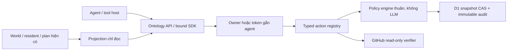

# Ontology: agent phát triển và domain mô phỏng

## Audit và quyết định kiến trúc

| Thành phần đã có | Tái sử dụng / ranh giới |
|---|---|
| `lib/world.ts`, `lib/living/schema.ts` | Person/Resident, nghề nghiệp, plan, quan hệ. Đây là domain mô phỏng; role nghề nghiệp không cấp quyền phát triển. |
| `lib/living/director.ts`, `expansion.ts`, event schema | Proposal/rules được kiểm tra độc lập với LLM; giữ nguyên planner, học, reward và source ownership. |
| `lib/store.ts`, `db/schema.ts` | D1 SQLite/Drizzle, snapshot revision; không cần graph DB. GET ontology không dùng `readWorld` vì helper đó có thể bootstrap/repair. |
| policy/ground/backfill stores | Tái sử dụng mô hình exact-source CAS, operation ID, batch và postassert; không ghi lại world/policy sang kho ontology. |
| `lib/admin.ts`, `worker/index.ts`, bounded-json | Giữ owner boundary hiện có. Namespace ontology có token riêng cho agent, không cấp quyền vào API cũ. |
| `.github/workflows/asset-maintenance.yml` | CI project có job `verify`; QA giữ workflow/deployment riêng. Chưa có GitHub client/service, Task/bug ownership hay Workflow runtime trong app. |
| PR template và runbook QA | QA/CI phải cùng SHA; build không thay authenticated runtime/independent QA. Ontology không tự merge hoặc deploy. |

## Kế hoạch theo phần nhỏ

1. **O1:** Schema, consistency, DAG/ownership/QA policy thuần và unit tests.
2. **O2:** Registry + D1 transactional state/audit/idempotency; fault/concurrency tests trước HTTP.
3. **O3:** Namespace API opt-in, token giới hạn theo agent và SDK/tool bindings; projection domain chỉ đọc, integration/legacy regression.
4. **O4:** GitHub read-only verifier đối chiếu repo/workflow/job/latest run/head SHA; kiểm các trường hợp giả, stale, failed và đổi head.
5. **O5 — rollout riêng:** backup/schema thật, apply migration0013, owner initialize/issue credential, nghiệm thu Access/traffic/native quota và QA cùng SHA trước tích hợp rộng. Không tự migrate hoặc merge QA/main.

## Hợp đồng thiết kế

Development entities: Agent, Repository, Workflow, Task (code/bug/review), PullRequest. Permission roles là catalog code, không phải prompt hoặc profession. Quan hệ typed: assigned_to, depends_on, part_of, targets và concerns (pointer born+actor của simulation). Một task có tối đa một owner/workflow/PR; dependency không được tự tham chiếu hoặc tạo chu kỳ. Không tạo quan hệ vào entity thiếu hoặc sai loại. Blocking là dữ liệu dẫn xuất, không có cờ thứ hai dễ bị lệch.

Workspace snapshot mới chỉ chứa dữ liệu phát triển. Giới hạn working set và JSON size làm lỗi rõ ràng thay vì tải graph vô hạn; adapter domain lấy source revision/born từ world hiện có và chỉ trả metadata cho phép. Sau giới hạn hiện tại có thể tách entity/relation sang bảng indexed trong D1 theo expand/migrate; chưa có lý do thêm graph database.

Quyền được server xác định: owner hiện hữu hoặc hash token ngẫu nhiên gắn agent, expiry/revocation và trạng thái agent. Không nhận role/principal từ body/header tự khai. Agent có thể đọc chung trạng thái qua API/SDK; mọi mutation qua registry, kiểm input/output, policy và revision. Token ontology không dùng được để sửa world hoặc gọi API owner cũ. Credential trả secret đúng một lần; audit/receipt không lưu secret, retry trả metadata để owner cấp token mới khi mất ACK.

Task todo → in_progress → in_review → done; assignee mới bắt đầu/gửi review. Reviewer agent không tự duyệt task mình sở hữu. Code/bug done cần PR và CI được server đọc lại; workflow complete cần các task hoàn tất và QA cùng head. Không có action merge/deploy hoặc shell execution; LLM không tạo evidence đáng tin bằng JSON.

GitHub verifier chỉ GET `api.github.com`, không nhận URL tùy ý. Required workflow path/job do owner cấu hình; kiểm repo ID, head, workflow identity, latest run/attempt và job completed/success. Không dùng check name hoặc client `{passed:true}` làm chứng cứ. Readback head lần cuối phát hiện đổi head trong quá trình kiểm. External state có thể đổi sau quan sát: evidence là timestamped observation, không phải quyền merge bền vững; action merge không tồn tại.

## Persistence và migration

0013 là expand-only: ontology_states, ontology_audit và ontology_credentials. Không backfill/reset world, memory, plan, policy hoặc journal cũ; không tăng cron/pulse/polling. Feature mặc định OFF, thiếu schema trả unavailable; GET không bootstrap. Initialize là action owner có audit. CAS state và audit cùng batch; postassert phát hiện silent-ignore/tamper và rollback. Operation ID gắn principal+canonical input hash, replay không thực hiện lại tác động. Audit append-only; token hash/expiry/revocation có journal mutation tương ứng.

Rollback vận hành: tắt `XOM_ONTOLOGY_ENABLED`; giữ bảng/audit/credential để điều tra. Trước bật remote phải backup+restore rehearsal, kiểm schema/binding/auth hiện hành theo [runbook](PRODUCTION_RUNBOOK.md). Không tự xóa bảng để rollback. Database hiện hành chưa được migrate bởi tác vụ này.

API, ví dụ và kết quả nghiệm thu được cập nhật cùng implementation. Backlog rollout duy nhất ở [ROADMAP](../ROADMAP.md).
